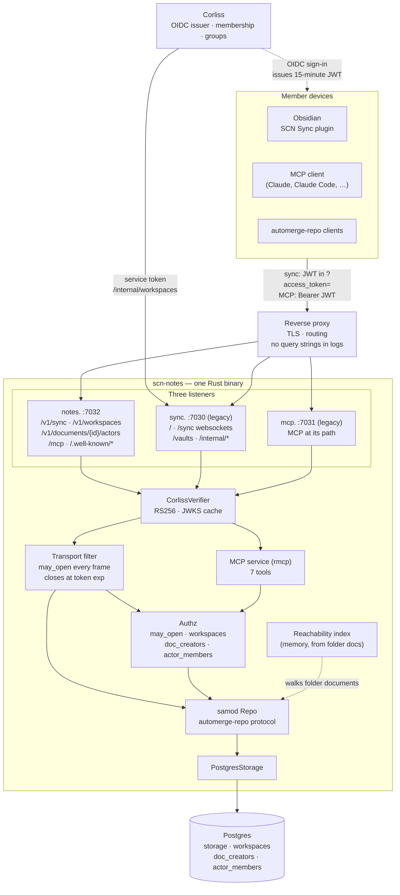

# scn-notes

The service behind SCN Notes on the Shared Computer Network: an Automerge
sync relay and an MCP server over the same documents. It speaks the
automerge-repo WebSocket protocol, so a standard `@automerge/automerge-repo`
client connects to it with nothing changed but a token in the URL, and it
persists documents to Postgres. It also serves those documents to MCP clients.

Built on [`samod`](https://crates.io/crates/samod), the Rust automerge-repo
implementation. A single static binary under systemd: no Node runtime, no
container.

## Architecture

Members' devices sync Automerge documents through the relay; MCP clients act as
the same member over the same documents. Corliss is the only source of identity
and group membership: it issues short-lived tokens, and the relay checks every
document access against the workspace the document belongs to.



- **Sync** carries Automerge changes. The filter decides per frame whether the
  connection's member may open the document it names, records who created a
  document first, and closes the socket when the token expires.
- **Authorization** is derived from the folder documents in a workspace and
  the `doc_creators` record. A folder entry is not enough: the workspace's owner
  (or a member of its group) must have created the document.
- **MCP** is the same repo behind a second listener, acting as the member in the
  token. Tools read and edit the same documents, so an MCP edit reaches every
  connected device through normal sync.

The proxy must never route `/internal/` on the `sync.` host and must not log
query strings on either sync route: the token rides there because a browser or
phone WebSocket cannot set an `Authorization` header. The `notes.` listener does
not serve `/internal/`, so that host can be routed whole.

## Status: Phase B

Every connection is authenticated as an SCN member and can open only that
member's Private workspace and the shared workspaces of their groups.

- **Sign-in is Corliss's.** The relay accepts access tokens issued by
  [Corliss](https://github.com/Z-Space-Society/Corliss), the network's OAuth
  provider, and resolves each to the member's DID. Corliss re-checks
  membership every time it issues one and they last 15 minutes, so access
  stops within one token lifetime of leaving the network.
- **A workspace belongs to one member or one group.** A workspace is a tree
  of folder and note documents under a root. A member's Private workspace
  opens to them alone. A shared workspace opens to every member whose token
  names its group. Groups are Corliss's (it calls them workspaces): it puts
  the member's group IDs in each token it issues, so the relay holds no
  roster, and leaving a group takes effect within one token lifetime.
- **MCP is built in.** A second listener serves the member's notes to an MCP
  client, acting as that member, from the same documents sync uses.
- **Each change is traced to a member.** Automerge stamps every change with a
  random actor ID, and the JS client picks a new one each time it opens a
  note, so an actor is one note on one device for one session. The relay
  records which member each actor belongs to when its first new change
  arrives on that member's connection. A change under an actor another member
  owns is dropped. MCP edits are written under an actor of the member's own.
  History stored before v0.6.0 is mapped once at startup: a note's first
  change goes to whoever created it, and every change in a Private workspace
  to its owner.

What this does not do:

- **It does not unshare the past.** A former member, of the network or of a
  group, keeps whatever their devices already hold.
- **It is not live co-editing.** Members' edits merge as they sync, the same
  way one member's devices do. Two people rewriting one sentence at once get
  both sets of characters interleaved.
- **It is not end-to-end encrypted.** The relay, and so its operators, can
  read every note. Notes sit in plaintext in Postgres.
- **It cannot name every past author.** Edits made before v0.6.0 to shared
  notes, other than each note's first change, stay unknown. Before v0.6.0 an
  MCP edit was written under the relay's actor for that note until the next
  restart, so when MCP created a note, other members' MCP edits to it in
  that time are traced to its creator. A note moved into a Private workspace
  from a shared one has its other members' earlier edits traced to the owner.

The design is in [`docs/specs/0001-spec-phase-b`](docs/specs/0001-spec-phase-b/0001-spec-phase-b.md).
Before v0.7.0 a workspace was called a vault; the spec keeps the old word.

## Configuration

All settings come from the environment; systemd loads them from an
`EnvironmentFile` written by Ansible.

| Variable | Default | Notes |
| --- | --- | --- |
| `SCN_NOTES_DATABASE_URL` | *required* | No in-memory fallback: a relay that silently ran on memory would look healthy until its first restart. |
| `SCN_NOTES_BIND` | `0.0.0.0:7030` | Sync and the workspace endpoints. Bind a wildcard. Binding a literal container address loses a cold-boot race with `systemd-networkd` and comes up loopback-only. |
| `SCN_NOTES_REQUIRE_AUTH` | `true` | Defaults on, so the safe posture is the one you get by forgetting. See "Running without auth". |
| `SCN_NOTES_OIDC_ISSUER` | *required with auth* | The `iss` every token must carry: Corliss's public URL, no trailing slash. |
| `SCN_NOTES_OIDC_JWKS_URL` | *required with auth* | Where to fetch Corliss's signing keys. Use its internal address. |
| `SCN_NOTES_SYNC_AUDIENCE` | *required with auth* | The `aud` a sync token must carry: the public sync URL, spelled exactly as Corliss's `OIDC_RESOURCES` spells it. |
| `SCN_NOTES_MCP_AUDIENCE` | *required with auth* | The `aud` an MCP token must carry: the public MCP URL, in lowercase with no trailing slash and no default port. Also the only `Host` the MCP service answers to, and its path is where the service is mounted. |
| `SCN_NOTES_MCP_BIND` | `0.0.0.0:7031` | The MCP listener. |
| `SCN_NOTES_PUBLIC_URL` | *required with auth* | The public URL of the `notes.` host: an origin with no path and no trailing slash, such as `https://notes.example.org`. A plugin's token there carries it as `aud`, and an MCP client's carries it with `/mcp` after it. The relay refuses to start on anything with a path or a trailing slash. |
| `SCN_NOTES_PUBLIC_BIND` | `0.0.0.0:7032` | The `notes.` listener. |
| `SCN_NOTES_SERVICE_TOKEN` | *required with auth* | The shared credential Corliss presents on `/internal/`. |
| `RUST_LOG` | `scn_notes=info,samod=info` | Standard `tracing` filter. |

With auth on and any of the required settings missing or blank, the relay
refuses to start and names the one it wants.

- **The audiences must match Corliss character for character.** A token
  whose `aud` differs by a trailing slash is refused, and the only symptom is
  a `401`. Define each URL once in the deployment and render it to both
  services.
- **The JWKS is cached.** It is fetched at startup and again when a token
  names a key the relay has not seen, at most every 30 seconds. If Corliss is
  down when the relay starts, the relay starts anyway and refuses every token
  until a fetch succeeds.

### Running without auth

`SCN_NOTES_REQUIRE_AUTH=false` runs the relay with no verifier and no
filter: any peer that can reach the port can sync any document it holds. It is
for local work and is only sound where the service has no route in. The MCP
service is not started in this mode, because there is no member for it to act
as.

## Endpoints

Three listeners while the old hosts are still served. From v0.7.0 members'
clients use the `notes.` listener; the sync and MCP listeners serve the old
`sync.` and `mcp.` hosts until they retire
([#19](https://github.com/Z-Space-Society/scn-notes/issues/19)). After that the
sync listener serves `/internal/` and `/health` only, with no public route.

On the `notes.` listener (`PUBLIC_BIND`), everything a member's clients reach:

| Path | Caller | Purpose |
| --- | --- | --- |
| `POST /mcp` | MCP client | MCP over Streamable HTTP. `Authorization: Bearer` with a token whose `aud` is `PUBLIC_URL/mcp`. Not versioned in the path: MCP agrees its protocol version when a client connects, and clients read the tool list each session. |
| `GET /v1/sync` | plugin | WebSocket upgrade; the automerge-repo sync protocol. The token rides in the query, `?access_token=`, with `PUBLIC_URL` as its `aud`. |
| `GET /v1/workspaces` | plugin | The caller's workspaces, as `{"workspaces", "root_folders"}`. Makes the Private workspace if they have none yet. `Authorization: Bearer` with the same token as `/v1/sync`. |
| `POST /v1/documents/{id}/actors` | plugin | The member behind each actor in a document (see [Actors](#actors)). `Authorization: Bearer` with the same token as `/v1/sync`. |
| `GET /.well-known/oauth-protected-resource` | anyone | The plugin's resource: `resource` is `PUBLIC_URL`, `authorization_servers` is the issuer. A plugin given only the notes URL finds Corliss here. |
| `GET /.well-known/oauth-protected-resource/mcp` | anyone | The MCP resource: `resource` is `PUBLIC_URL/mcp`. A refused MCP request points here. |
| `GET /health` | anyone | Liveness, as on the sync listener. |

- **The base URL and the audiences are never versioned.** The plugin adds the
  API version it was built for. Inside `/v1/` changes only add things; a
  breaking change is `/v2/`, served beside `/v1/`, never a change to `/v1/`.
- **`/` is left free**, for pages if the service ever has any.
- **Nothing else answers here.** Any other path is a `404`, including the old
  host's `/` websocket and `/vaults`, and `/internal/` is not served on this
  listener at all, so the proxy can route the whole host.

On the sync listener (`BIND`):

| Path | Caller | Purpose |
| --- | --- | --- |
| `GET /` | sync client | WebSocket upgrade; the automerge-repo sync protocol. **This is the one clients use**: `WebSocketClientAdapter` connects to exactly the URL it is given and appends no path, so clients are configured with a bare `wss://host`. |
| `GET /sync` | sync client | The same handler, for a client configured with an explicit path. |
| `GET /vaults` | member | The caller's workspaces, in the shape before v0.7.0 (see below). Makes the Private workspace if they have none yet. `Authorization: Bearer` with a sync token. |
| `GET /internal/workspaces?did=&groups=` | Corliss | A member's Private workspace, plus the workspaces of the comma-separated group IDs. Makes the Private workspace if they have none yet. `Authorization: Bearer` with the service token. |
| `PUT /internal/workspaces` | Corliss | A group's workspace: `{"did", "group_id", "name"}`, `did` being the member asking. Made if the group has none, and given `name` either way, so the same call serves the group's page, its creation and its rename. Returns `200` and the workspace. |
| `GET /internal/workspaces/all` | Corliss | Every workspace with the DID that made it, and per creator the documents no workspace reaches. For Corliss's admin view. Takes no parameters. `Authorization: Bearer` with the service token. |
| `GET /internal/vaults?did=&workspaces=`, `PUT /internal/vaults/workspace`, `GET /internal/vaults/all` | Corliss before v0.7.0 | The three above, in the shape before v0.7.0. |
| `GET /.well-known/oauth-protected-resource` | anyone | Which authorization server issues sync tokens: `resource` is `SYNC_AUDIENCE`, `authorization_servers` is the issuer. A sync client given only the sync URL finds Corliss here. Not served with auth off. |
| `GET /health` | anyone | Liveness and the current auth mode. Does not touch Postgres, so a database blip cannot get the relay restarted out from under live connections. |

On the MCP listener (`MCP_BIND`):

| Path | Purpose |
| --- | --- |
| `POST <MCP path>` | MCP over Streamable HTTP. `Authorization: Bearer` with an MCP token. |
| `GET /.well-known/oauth-protected-resource<MCP path>` | Which authorization server issues tokens for this resource. Unauthenticated; it is how an MCP client finds Corliss. |

Things the proxy in front has to get right:

- **Do not route `/internal/` on the `sync.` host.** Those endpoints are for
  Corliss on the internal network. The service token is the only thing
  guarding them. The `notes.` listener does not serve them.
- **Do not log query strings on either sync route.** A browser or phone
  websocket cannot send an `Authorization` header, so a sync client connects
  to `wss://host/?access_token=<token>`, or `/v1/sync?access_token=` on the
  `notes.` host. The relay never logs it.

### Sync

A connection with no token, or an expired or wrong-audience one, gets `401`
before the upgrade. Once connected:

- A request for a document the member may not open is answered with
  `doc-unavailable`, the same answer a document that does not exist gets.
- A request from a group member for a document someone else has just
  linked into a shared workspace waits up to 3 seconds for the relay to admit
  it, rather than being refused while the relay catches up. A refusal would
  stick until the client reconnected.
- The relay never offers a document unasked. A client requests the documents
  its folder documents list, on every connection.
- The connection is closed with code `1008` and reason `token expired` when
  its token's `exp` passes. The client reconnects with a fresh token.

### Actors

The plugin reads a note's history from its own copy, where each change names
only an actor ID. `POST /v1/documents/{id}/actors`, with `{id}` the document
ID and a body of `{"actors": ["<actor hex>", ...]}` (at most 1000), answers:

```json
{ "actors": { "<actor hex>": { "did": "did:plc:..." } } }
```

- Every actor asked about is in the answer. `did` is `null` when the relay
  does not know whose it is, which is most edits to shared-workspace notes
  from before v0.6.0, and also for an actor that made no change in this
  document, so a caller learns nothing about documents they cannot open.
- A document the caller may not open is a `404`, the same as one that does
  not exist. A bad actor ID or too many is a `400`.
- Each actor is an object so that more about the member, such as a handle or
  name, can be added within `/v1/`.

### Workspaces

A workspace is one JSON object:

```json
{
  "root_doc_id": "<document ID>",
  "url": "automerge:<document ID>",
  "name": "<the group's name, or null for a member's Private workspace>",
  "group_id": "<group ID, or null for a member's Private workspace>",
  "path": "<Private, or Workspaces/<name>>",
  "created_at": "<RFC 3339 timestamp>",
  "last_change_at": "<RFC 3339 timestamp, or null>",
  "note_count": "<integer, or null>",
  "bytes": "<integer, or null>"
}
```

`note_count` and `bytes` are null until the relay has walked the workspace
since it started, and `bytes` is filled in by the listing endpoints only:
the MCP tools list workspaces on every call and do not pay for the query. It
is the bytes the workspace's documents take in storage, which is their
Automerge history. It grows with every edit and reads larger than the notes
as files.

Listings return `{"workspaces": [...], "root_folders": ["Private",
"Workspaces"]}`, oldest first. `root_folders` names the folders workspaces sit
under, even when the member has none in one, so a client can show the folder
without spelling the word. Errors on the internal endpoints are
`{"error": "<code>"}`: `400` with `invalid_did`, `invalid_name` or
`invalid_group`. A member has one Private workspace, which has no name. A
group has one workspace, named 1 to 100 characters.

**The shape before v0.7.0**, still served on `GET /vaults` for plugins up to
1.2.x and on `/internal/vaults` for the Corliss before the rename: the listing
is `{"vaults": [...], "folders": [...]}`, each entry names its group as
`workspace` instead of `group_id`, the internal calls take `workspaces=` and
`"workspace"`, and a bad group ID is `invalid_workspace`. These go when `sync.`
retires ([#19](https://github.com/Z-Space-Society/scn-notes/issues/19)).

`path` is `Private` for a member's Private workspace, and the name under
`Workspaces` for a shared one. The relay is the only place those words are
spelled: MCP names workspaces by `path`, the Obsidian plugin puts each
workspace in a folder at its `path`, and Corliss shows it. A client builds
none of it.

In a token, groups are the `workspaces` claim (Corliss's word), an array of
group IDs such as `["7", "12"]`. A token without it is in no group. An ID is 1
to 64 ASCII letters, digits, `-` and `_`, and is opaque on purpose: a sync
client sends its token in a websocket URL, so the token names no group in
words. A shared workspace carries its group's name, which Corliss sends with
every `PUT /internal/workspaces`, a rename included.

**Admission.** A document joins a workspace only if the workspace admits its
creator: for a Private workspace, the member made it; for a shared one, its
creator's token named the group when they first sent it. So a member cannot
pull someone else's document into a workspace by writing its URL into a
folder, and a note stays in a shared workspace after its author leaves the
group.

Workspaces are made by the relay and nowhere else: a member's Private
workspace the first time any listing asks for it, a group's the first time
Corliss asks for it. The relay sees group IDs only, never names, which is why
a shared workspace waits for Corliss. No sync client makes one.

A member has one Private workspace. If a member has two, startup fails rather
than merge them silently.

**The admin listing.** `GET /internal/workspaces/all` answers:

```json
{
  "workspaces": [{ "owner_did": "<DID>", "...": "a workspace, as above" }],
  "unfiled": [{ "did": "<DID>", "docs": 3, "bytes": 1234 }]
}
```

- **It takes no parameters, on purpose.** The other listings name a member,
  and a request choosing whose workspaces it gets is the thing Corliss guards
  against. This one has nothing to choose: it is everyone's or a `401`. A
  query string is ignored rather than read. Who may see the answer is
  Corliss's question, asked by the admin gate on the one page that calls it.
- **Counts and sizes, never titles or text.** It walks no folder for names
  and reads no note. Seeing what members have stored is a different
  decision from seeing what they wrote.
- **`owner_did` is here and in no member's listing.** For a shared workspace
  it is the member who made it, which the group's other members have no need
  to learn.
- **`unfiled` is each creator's documents that no workspace reaches**, by
  `doc_creators`: deleted entries, a move cut off part way, a note whose
  folder never arrived, and entries of a type the relay does not index. With
  the workspaces' `bytes`, it adds up to what each member holds in storage.
  It is `null` until every workspace has been walked since startup, because
  until then an unwalked workspace's notes would be counted as unfiled.
- **It runs the size query over every workspace and every unfiled
  document.** That is fine at today's size, and it is what to revisit if the
  admin page gets slow.

**Filing a member's unfiled documents.** `scn-notes file-unfiled <did>
[--folder <name>] [--apply | --delete]` lists the documents of `<did>` that no
workspace reaches. With `--apply`, it links them into a new folder
(`Recovered` unless named) at the root of that member's Private workspace,
where they appear on every device. With `--delete`, it removes them instead,
each with everything it holds: their stored history and their creator rows,
in one transaction, after checking again that each is still the member's and
in no workspace.

- **Run it with the service stopped**, with the service's environment, so
  that nothing else writes the workspace's root folder at the same time. It
  waits for the index to walk every workspace, and exits once the folder is
  written.
- **It reads what the admin listing does not**: each note's name and first
  line, and each folder's title. Run it for a member who asked, and show the
  list to them.
- **Only the top of each tree is filed.** A deleted folder comes back whole
  with its notes inside it, and its notes are not filed a second time. Two
  entries with one name get the plugin's conflict name. Documents that are
  neither notes nor folders are listed and left where they are.
- **It refuses rather than guesses** when the workspace already has an entry
  with the folder's name.

### MCP tools

Every tool acts as the member the token names, in the groups it names. A
path starts with its workspace, the same path the Obsidian plugin puts the
file at: `Private/...` for the caller's own, `Workspaces/<name>/...` for a
shared one, in any letter case. Every path a tool returns is written the same
way. A path that starts with neither is refused with a pointer to
`list_notes`, and two shared workspaces with one name are refused rather than
guessed between.

| Tool | Does |
| --- | --- |
| `list_notes` | With no path, the caller's workspaces (`Private` and each `Workspaces/<name>`). With `Workspaces`, the shared ones. With a workspace or folder, what is in it. |
| `read_note` | A note's markdown |
| `search_notes` | Notes containing every word of a query, across every workspace, or in the workspace or folder given as `path` |
| `create_note` | A new note at a path, with any folders on the way |
| `edit_note` | Replace one piece of a note's text with another |
| `append_note` | Add text to the end of a note |
| `note_history` | A note's changes, its text at an earlier version, or the diff between two versions |

The service is stateless: no session is issued and each request carries its
own token, so a relay restart needs nothing from the client. There is no tool
to delete a note.

#### History

`note_history` takes the same path and makes the same checks as `read_note`,
and never changes the note.

- **With no version**, it lists the note's changes newest first, in groups: a
  run of changes under one Automerge actor, which is one member's session on
  one device, or a stretch of their MCP edits. Each group has an `id`, the
  member's DID, the device's time at its first and last change, and the
  characters added and removed. `limit` caps the groups (20 by default, at
  most 100).
- **With `version`**, one group's `id`, it returns the note's text as that
  change left it. To restore it, create a new note from that text; nothing
  rewinds a note in place, since that would discard other members' later
  work.
- **With `version` and `compare_to`**, it returns what changed between them:
  each stretch of removed and added text, with the line it starts on.

A version is the note as one change left it: that change and everything it
was made on top of, not edits another device made at the same time.

Who made a change comes from the actor map (see [Status](#status-phase-b));
a change the relay cannot attribute shows as `unknown`, which is most edits
to shared-workspace notes from before v0.6.0.
Times are whatever each device's clock said, so they can be wrong or out of
order. The relay's own MCP edits carry its time from this version on; earlier
ones have none.

Removed text is shown, not hidden. Every member's device already syncs a
note's full history, so hiding it would protect nothing, and showing an
earlier version shows it anyway. Text deleted from a shared note stays
readable to everyone in that workspace.

## Storage

Tables created at startup. The deployment provisions the database and its
owning role, not the schema.

```sql
CREATE TABLE storage (key TEXT PRIMARY KEY, value BYTEA NOT NULL);
CREATE INDEX storage_key_prefix ON storage (key text_pattern_ops);

CREATE TABLE workspaces (
  root_doc_id    TEXT PRIMARY KEY,
  owner_did      TEXT NOT NULL,
  name           TEXT,
  created_at     TIMESTAMPTZ NOT NULL DEFAULT now(),
  last_change_at TIMESTAMPTZ,
  group_id       TEXT
);
CREATE UNIQUE INDEX workspaces_private ON workspaces (owner_did)
  WHERE group_id IS NULL;
CREATE UNIQUE INDEX workspaces_group ON workspaces (group_id)
  WHERE group_id IS NOT NULL;

CREATE TABLE doc_creators (
  doc_id      TEXT PRIMARY KEY,
  creator_did TEXT NOT NULL,
  created_at  TIMESTAMPTZ NOT NULL DEFAULT now(),
  groups      TEXT[] NOT NULL DEFAULT '{}'
);

CREATE TABLE actor_members (
  actor_id      TEXT PRIMARY KEY,
  did           TEXT NOT NULL,
  source        TEXT NOT NULL,
  first_seen_at TIMESTAMPTZ NOT NULL DEFAULT now()
);
CREATE TABLE relay_jobs (name TEXT PRIMARY KEY, done_at TIMESTAMPTZ NOT NULL DEFAULT now());
```

`storage` holds the documents. `workspaces` names each workspace's creator,
its group if it has one, and its root document. `doc_creators` records who
first sent each document and the groups their token named then, and is what
decides ownership: losing it loses every member's access to their own notes,
so it is as much the store of record as `storage` is. `actor_members` maps
each Automerge actor to its member.

**From a relay before v0.7.0.** A database with a `vaults` table is first
brought up to v0.6.0's shape by the statements older relays ran, then
renamed in one transaction: `vaults` becomes `workspaces`, `workspace_id`
becomes `group_id`, `doc_creators.workspaces` becomes `groups`, and the
indexes follow. The data is untouched.

samod's `StorageKey` guarantees no component contains a `/`, so a key round
trips as `Display` out and `split('/')` back, with no escaping.

`text_pattern_ops` is load-bearing: the default opclass follows the database
collation and will not serve a `LIKE 'prefix%'` scan, which would quietly turn
every range read into a full scan of a table that only grows.

### Inspecting storage

A workspace's `bytes` is the one per-workspace figure: only the relay's
index knows which documents a workspace holds, so SQL alone cannot split
`storage` by workspace. `GET /internal/workspaces/all` gives it for every
workspace, with each member's
unfiled documents beside it. These answer the rest, in `psql` against the
relay's database.

```sql
-- The database and the storage table, on disk.
SELECT pg_size_pretty(pg_database_size(current_database())),
       pg_size_pretty(pg_total_relation_size('storage'));

-- Snapshot and incremental rows: many incrementals means not yet compacted.
SELECT split_part(key, '/', 2) AS kind, count(*),
       pg_size_pretty(sum(octet_length(value)))
FROM storage GROUP BY 1;

-- Documents nobody is recorded as sending: open to nobody, in no workspace.
-- This is how leftovers get spotted.
SELECT split_part(key, '/', 1) AS doc, sum(octet_length(value)) AS bytes
FROM storage
WHERE split_part(key, '/', 1) NOT IN (SELECT doc_id FROM doc_creators)
GROUP BY 1 ORDER BY 2 DESC;
```

## Naming

The software was called `scn-sync-relay` before v0.7.0. The software's own
names follow the crate: the binary, the systemd unit, the unix user, the
install paths and the `SCN_NOTES_` env prefix are all `scn-notes`. The
cluster's names for the service keep the old spelling on purpose: the zai-ops
role `sync_relay`, the `sync-relay` container and its CTID, and the
`scn_sync_relay` database. Renaming those would touch a recorded container
assignment and the database that holds the notes, for nothing a member sees.

## Building

```sh
cargo build --release
```

`Cargo.lock` and `rust-toolchain.toml` are committed, so two builds months
apart produce the same binary from the same contents. Build against the
target's glibc — building on macOS would need a cross-compile or a static musl
target.

## Testing

```sh
DATABASE_URL=postgres://localhost/postgres cargo test
```

Most tests need a Postgres server. `DATABASE_URL` names any database on it
that the user may create databases from: each test gets a database of its own
and drops it when it passes.

## Releasing

Deployment checks out an **annotated tag**, so the tag has to reach the remote:

```sh
git tag -a v0.1.0 -m "v0.1.0"
git push origin main --follow-tags
git ls-remote --tags origin       # the check that matters
```

A tag that exists only locally fails at checkout with `pathspec 'v0.1.0' did
not match`, which reads like a bad version pin rather than an unpushed tag.

## License

Apache-2.0.
